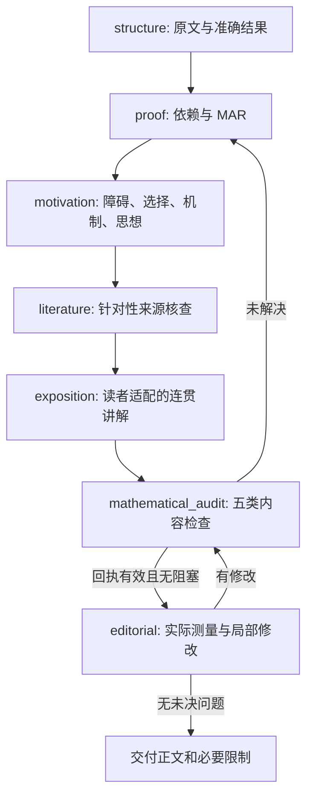

# 数学理解与讲解的 Prompt 工程

当前 Prompt 版本为 `2.0.0`，可执行正文位于 [prompts.py](../src/math_exposition/prompts.py)。这里说明设计依据、数据合同、交接门槛、实例与评价。不是一次性把全文与所有规则塞入上下文：一次调用只准备一个阶段，并携带该阶段需要的实际结构与证据。

## 1. 目标、职责与可验证范围

理解拆成局部、结构和思想三层：局部检查某一步如何成立；结构检查哪些事实共同得到主定理；思想说明具体障碍如何被构造和方法跨越。三层共享同一套原文锚点，不各自生成一份可能矛盾的摘要。

Python 提供文本结构、身份、证据核对、图运算、任务门槛和测量。调用模型负责数学解释，外部检索工具负责实际取得文献，人类审阅者负责重要数学判断的独立检查。没有自动证明器、隐式联网、第二模型调用或已经验证的能力提升。

本版采用一个总控、四个理解阶段、一个表达阶段和两个审核阶段。同一个模型可按顺序执行，不以多模型数量作为设计目标。



## 2. 数据合同和原文重读

固定 schema：`math-document/1` 保存原文；annotations 保存模型分析；`proof-reconstruction/1` 是程序计算结果；`mathematical-task/1` 是阶段任务；`exposition-audit/1` 是双重审核回执。模型不能以自己写出的 `passed=true` 替代程序计算。

MAR 的九类内容是完整 Statement、Hypotheses、Conclusion、Dependencies、Obstruction、Mechanism、Idea、Origin 与 Verification status。字段及锚点见[随技能分发的协议](../references/mathematical-understanding.md)。Origin 由 claims 与实际外部来源表达，不通过自由文本填写一个未经取回的参考文献名称。

模型提交的原文引文必须与实际区间逐字相等，source ID 必须匹配完整原文 SHA。数学重构的解释不要求逐字摘录，但其 evidence 必须是实际支撑该解释的原文。程序能证明“引文存在”，不能证明“引文蕴含该解释”。

长文读取的具体协议：

1. 先提交完整源文或逐块精确拼接，保留结构目录。不同版本分别登记，不混用偏移。
2. 按结构读全文，使用阅读覆盖 anchor 记录区间。程序合并覆盖区间，报告未读空洞。
3. 主定理反向寻找前提时，重新读取定义、关键证明段与附录，不依赖上一阶段摘要。
4. 检查拓扑序只用于正向解释顺序；读者已知节点仍存在于依赖图。
5. 外部来源单独登记，以自己的 SHA 和原文偏移引用；原论文参考文献列表不能替代来源正文。

覆盖记录是一次阅读声明，不是理解检测。给全文一个 anchor 也不能证明模型真读懂了内容；效果评价要另查实际依赖和解释。

## 3. 总控 Prompt 与各阶段合同

总控约束阶段顺序、证据格式、数学优先级、归属层级和失效回退。各阶段只输出可检查的数学工作材料；不要求披露隐藏思考过程，不把“请深入思考”当成工程接口。

| 阶段 | 最小输入 | 产物 | 程序检查与后续门槛 |
|---|---|---|---|
| structure | 原文、警告、指定范围、读者背景 | 主要结果、全局假设、notation、reading_coverage、source_gaps | 原文身份和节点偏移可重建；下一步仍需模型核对提取边界 |
| proof | 准确结果、完整证明、外部条件 | 方向明确的 edges、局部步骤、coverage、初步 arguments | 证据逐字相等；已知节点；无重复/自环/环路；计算必要闭包 |
| motivation | 图、关键构造原文、缺口 | obstruction/mechanism/idea、分类 claims、待核问题 | 缺失 MAR、unresolved 与错误归属形成 findings |
| literature | 关键来源问题、本文引文 | 实读 external_sources、方法比较与检索账本 | 历史来源无外部正文时阻塞；不声称程序已联网检索 |
| exposition | 已完成 MAR、依赖顺序、读者知识 | article、claim_map、删去背景的理由、open_issues | 图 findings 不为空时拒绝准备正文任务 |
| mathematical_audit | 正文、原文、MAR、baseline | 五类审查 checks、候选哈希、原文 evidence | 区间/源文/哈希匹配；缺项、fail、unresolved 不进入润色 |
| editorial | 当前审核回执、真实测量、风格规则 | article、局部 changes、保留异常的理由 | 重新计算审核门槛和测量，不接受伪造成功布尔值或过期回执 |

structure 的 source_gaps、notation、exposition 的 claim_map 和 editorial 的 changes 是模型工作材料，目前没有全面语义验证器。不得把 JSON 字段存在描述为论证已核实。

## 4. Proof Reconstruction 的操作细节

重建的基本单位是“这一步需要什么事实”，不是“文中提到什么编号”。目标定理 T 可先拆为存在、唯一、不变性、实现性或估计等子目标，但只在原证明确实涉及时拆分。

对每条边必须回答三个可核查问题：前提给出的事实、目标的使用位置、事实如何跨过当前障碍。不要把 role 写成“为定理提供基础”。例如“投影引理把最优系数的像限定到唯一的 y*，纤维引理再描述全部原像”具有可检查的接口。

同时保存两层关系：论文层的定义/引理/主结果，局部层的关键推导。局部步骤可用手工 proof 节点表示；检查量词见证、反证假设解除、交换极限和积分、局部拼接、参数一致性等真正决定结论的步骤。

常见误判与修复：

| 误判 | 应重新读取的材料 | 修复结果 |
|---|---|---|
| 有 ref 就连证明边 | 引用前后及目标证明 | 对照/例子引用不连边；实际使用另写 role |
| 定理条件只在环境里 | 章节约定、定义、全局参数 | 补入 Hypotheses，保持作用域和量词顺序 |
| 外部结果当黑箱 | 引用原定理与本处对象条件 | 完成假设匹配；否则 coverage=assumed/gap |
| 同一编号造成循环 | 归纳层次、分步加强、延后证明 | 拆开不同逻辑阶段，不删除真实依赖 |
| 每一步都解释但主证明不连贯 | 各引理输出和下一步输入 | 补接口和目标闭包，不按章节顺序复述 |

结构错误可局部修复；主定理陈述或原文版本变化时，后续动机、讲解和审核均需失效重建。

## 5. Mathematical Motivation Reconstruction 的操作细节

先完成四元组，再讨论一般思想：

```text
障碍：当前缺的具体数学事实是什么？
选择：引入了哪个对象、条件或归约？
机制：哪个等式、构造、提升、估计或相容性真正填补缺口？
思想：该机制依赖什么结构，能在什么范围内迁移？
```

每个字段都连接证明节点和原文，不允许四句话分别来自不同主题而没有逻辑接口。

以最小二乘为例，障碍是唯一最优拟合向量并不能直接给出唯一系数；选择是先在像空间优化，再求该向量的纤维；机制是正交分解保证前者唯一，而线性性将后者写成核的平移。可以归纳为分离“像空间的优化”与“原像中的自由度”。不能仅写“投影揭示本质”，也不能声称作者历史上就是这样发现结果。

三个针对性压力案例：

| 场景 | 容易写出的错误解释 | 必须核实的事实 |
|---|---|---|
| 上同调作用与自映射 | “诱导同态完成映射分类” | 不变量是否完备、代数态射是否可实现、空间/系数条件在哪里使用 |
| 幂等算子与代表元 | “P²=P 因而给出规范代表” | 像、核、等价关系相容、代表的存在/唯一及后续用途 |
| 收敛与积分交换 | “点态收敛说明积分收敛” | 是否有统一可积控制或其他实际使用的条件，在哪里应用外部定理 |

条件删除测试要记录三种不同结论：当前证明哪一步失效；是否找到结论本身的反例；是否只是尚不清楚能否有其他证明。只有第二种有证据时才能支持条件必要性。不得由“这个方法需要 H”改写成“结论必须有 H”。

思想迁移也有完成门槛：新对象是否满足定义域要求，构造是否良定义，存在/唯一/相容性是否保持。没有完成这些检查的推广只能列为待核联系。

## 6. 来源归属与检索预算

| 判断 | 允许的记录 | 不允许的跳跃 |
|---|---|---|
| 作者明确陈述的动机 | author_motivation + explicit_source + 本文原文 | 引言概括不足以证明每个技术选择的心理过程 |
| 数学上的用途解释 | mathematical_motivation + reconstruction + 证明证据 | 不能归为作者亲述或历史事实 |
| 思想联系尚未证实 | unverified，保留具体待核项 | 不能改成“借鉴”“首次”“受到启发” |
| 思想/方法来源 | historical_origin，本文与已读原始来源 | 有引文或相似词汇不等于最早发现 |

检索服务于一个已经定位的问题。先读本文引文，再查原始工作；建议每问题最多两轮针对性补检，仍未解决就记录 unanswered。这个预算是避免无目标扩展的建议，不是支持断言的证据。

本地 MCP 不包含搜索引擎。调用模型必须使用环境中实际可用的工具；没有工具就交付清楚的证据缺口，不虚构检索日志。历史来源检查可降级为不作历史断言，但不能只改 basis 名称掩盖未解决的数学问题。

## 7. 审核、局部修订与失效规则

数学审核先形成待核断言与独立问题，再回原文回答，最后修订。五类 checks 中每项都要有候选片段、理由、源文锚点和 pass/fail/unresolved。review 同时绑定 document_id、candidate_sha256 和程序返回的 reconstruction_sha256；即使正文没变，证明图或 MAR 改变也须重新审核。模型提交的回执仍是模型审查记录，不能冒充独立专家意见。

baseline 是本轮开始时已核对的讲解，不是论文全文。改写可以重排材料，整篇论文和讲解的公式序列本来不同；内容保护必须比较同轮草稿。明确授权的公式更正另行检查并更新基线。

统计审核实际调用现有八项仪器，返回完整测量、句段位置、可比性和缺失原因。显式选来源时验证冻结结果 SHA，返回描述性区间；不要求稿件靠近区间。不能根据物理行量声称测出了段落信息负担，也不能根据句长自动断言条件被拆散。

Editorial Review 只在具体阅读障碍存在时修改。每项 changes 记录 before 区间、after、相关实测观察、收益与数学风险；没有障碍可以保留统计异常。每次修改后候选哈希失效，重新做数学审核、保护检查和统计测量。没有新问题时停止，不以达成数值分布为循环终点。

## 8. 工程与行为评价

工程回归核查：原文身份/Unicode 位置、虚构引文、错误来源、图方向和环路、未读中部、无证据归属、错误作用域、已知背景不移除前提、同稿统计、过期审核、公式改变，以及真实 MCP 传输。见 [测试目录](../tests)。这些不证明模型行为改善。

行为评价准备三篇不同证明结构的真实论文：代数拓扑重点检查分类与实现性；几何重点检查局部到整体及构造条件；分析重点检查估计、极限和条件作用。尚未选择固定论文，也未运行模型对照。不得把原创小型线性代数例子写成这一实验的结果。

每个样本先由熟悉该领域的人核对源文版本、目标定理、必要/可选依赖边、关键步骤、条件使用点、允许的动机解释和历史来源。标注者有分歧时记录可接受替代结构，不强迫唯一讲解路线。

比较以下条件，固定模型版本、论文、读者背景、可用工具、输出要求和合理预算，并记录实际 token/时间及取回来源：

1. 直接解释：只给论文和读者目标。
2. 加证明重建：增加 structure/proof。
3. 加动机重建：增加 motivation。
4. 加来源核查：增加 literature。
5. 加真实统计与局部修订：增加 editorial；保留相同数学审核。

随机呈现文章，评价者不知道使用了哪个条件；分析和评价材料分开。统计每个阶段失败发生在哪一处，不用更长文章天然胜出的总分。

| 评价项 | 可核对观察 | 不能据此宣称什么 |
|---|---|---|
| 依赖准确/完整 | 必要边召回、无效边、关键局部步骤遗漏，允许等价分解 | ID 匹配率不能代替数学判断 |
| 机制与思想 | 障碍和构造是否对应、关键推导正确、条件删除解释准确 | 流畅或引用多不等于理解 |
| 证据与归属 | 重要断言有无实际支持、未核实联系是否正确标注 | 存在引文不等于引文支持结论 |
| 读者适配 | 能否回答验证理解的问题、无关背景量、需要补问的关键步骤 | 主观自然度不能抵消数学错误 |
| 表达反馈收益 | 同稿局部变化、读者偏好、保护失败与新增错误 | 数值更接近参考不等于改善 |

新增的数学错误、条件丢失和错误历史归属作为单独失败报告；不得由总体可读性分抵消。评价者与模型自查意见冲突时保留原始判断和复核依据。Prompt 修改后旧样本成为开发材料，不能重新叫作未见测试。

## 9. 研究线索与待核实状态

用户调研报告提及以下资料，作为设计线索保留；本次没有逐项取回原文核验，不沿用报告中的年份、数据规模或效果数值作为本项目证据：

- [Proof Comprehension assessment](https://eric.ed.gov/?id=EJ948400)：局部、结构与方法理解的评价线索。
- [Understanding in Mathematics: The Case of Mathematical Proofs](https://doi.org/10.1111/nous.12489)：高层组织与细节关系的线索。
- [ProofFlow](https://proceedings.iclr.cc/paper_files/paper/2026/hash/5fce5198dbf92d5ff45f74504431e2ff-Abstract-Conference.html)、[Matlas](https://arxiv.org/abs/2604.17484)：依赖表示和前置知识检索的线索。
- [PaperQA](https://github.com/Future-House/paper-qa)、[OpenScholar](https://www.nature.com/articles/s41586-025-10072-4)：针对性检索、来源支撑与修订的线索。
- [Least-to-Most](https://arxiv.org/abs/2205.10625)、[Self-Explanation](https://eric.ed.gov/?id=EJ1028348)：阶段化与关系解释的线索；人类学习结果不直接证明 GPT 提升。
- [Chain-of-Verification](https://aclanthology.org/2024.findings-acl.212/)、[Lost in the Middle](https://aclanthology.org/2024.tacl-1.9/)：独立核查问题与分块重读的线索；数学效果仍需本项目评价。

Prompt 正文有显式版本；修改时同时记录行为变化、对应失败案例和回归结果。版本号、工程通过或文献链接数量都不代替真实论文与读者验证。
