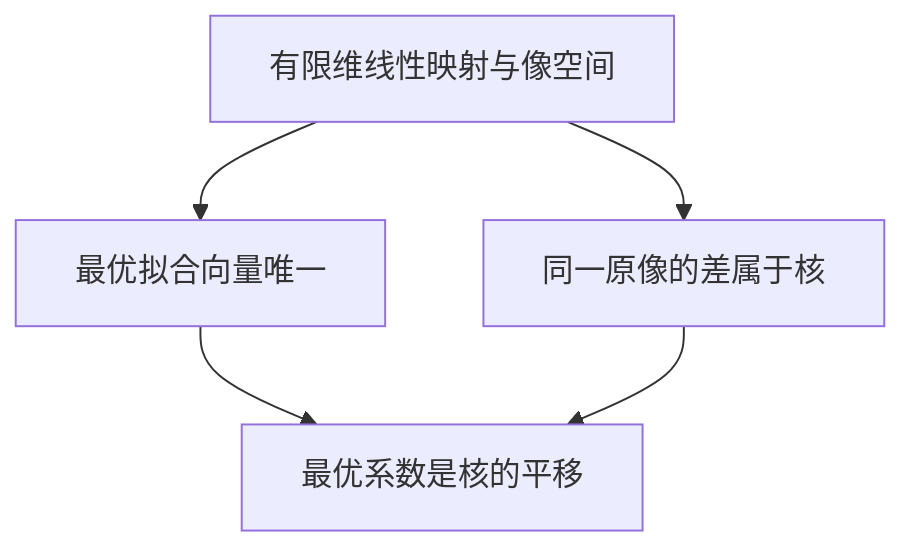

# 可重放的论证结构示例

此例用有限维最小二乘演示原文锚点、证明依赖和审核门槛。原文见 [argument.tex](argument.tex)，标注见 [argument.annotations.json](argument.annotations.json)，讲解草稿见 [argument.exposition.txt](argument.exposition.txt)。材料为本项目编写的教学片段，标注来自示例自查。

主结果为所有最优系数构成核的平移。内部结构区分两个用途：正交投影确定唯一最优拟合向量，核的纤维刻画全部最优系数。最后的 remark 不在主结果的必要闭包中。

讲解采用直接陈述，符号与短等式行内展示，独立公式计数为 0。依赖图保留在工作材料中，正文按投影、纤维与结论的逻辑衔接展开。



从仓库根目录运行，先准备已忽略的输出目录。每次用不存在的回执文件名，命令不会覆盖已有回执：

```sh
python -m pip install -e .
mkdir artifacts
style-compiler read-paper examples/argument.tex -o artifacts/argument.document.json
style-compiler reconstruct artifacts/argument.document.json examples/argument.annotations.json
style-compiler prepare-explanation motivation artifacts/argument.document.json --annotations examples/argument.annotations.json --reader "熟悉线性代数，不熟悉该证明"
style-compiler prepare-explanation exposition artifacts/argument.document.json --annotations examples/argument.annotations.json --known-node n1
```

`reconstruct` 应返回 `prerequisite_order=[n1,n2,n4,n6]`、空 findings 和 `mathematical_validity=not_certified`。已知 n1 只减少背景讲解，不从图中删除它。原文和讲解的公式可能重排，保护基线使用本轮讲解草稿。

```sh
style-compiler audit-exposition artifacts/argument.document.json examples/argument.annotations.json examples/argument.exposition.txt examples/argument.exposition.txt
```

这一步返回草稿的八项实际测量、`presentation` 计数和 `editorial_revision_allowed=false`，退出码为 2。原因是尚未提交五类数学审查回执；公式与句型的机械检查不能完成该审查。

然后调用 `prepare-explanation mathematical_audit`，提供 `--baseline` 和 `--candidate` 为上述讲解草稿。按任务检查条件、依赖、机制、归属和范围，以 `review` 格式保存真实审查；再传给 `audit-exposition --review ...`。只有审查当前稿、五项 pass、无图 findings 和受保护内容变化，才能准备 editorial 任务。这里刻意不分发一份假装已经独立审核的 pass 文件。

可尝试的负例：修改某个 evidence.quote；给图添加反向边形成环；删除正文中部 reading_coverage；把 mathematical_motivation 改成 author_motivation 而保留 reconstruction；向候选加入与基线不同的公式。它们分别触发证据拒绝、环路拒绝、未读缺口、归属 findings 和保护阻塞。

这些例子验证程序能检查工作材料，不验证模型真的理解任意论文。三篇真实论文的盲评和消融仍待执行，见 [评价方案](../docs/prompt-engineering.md)。
